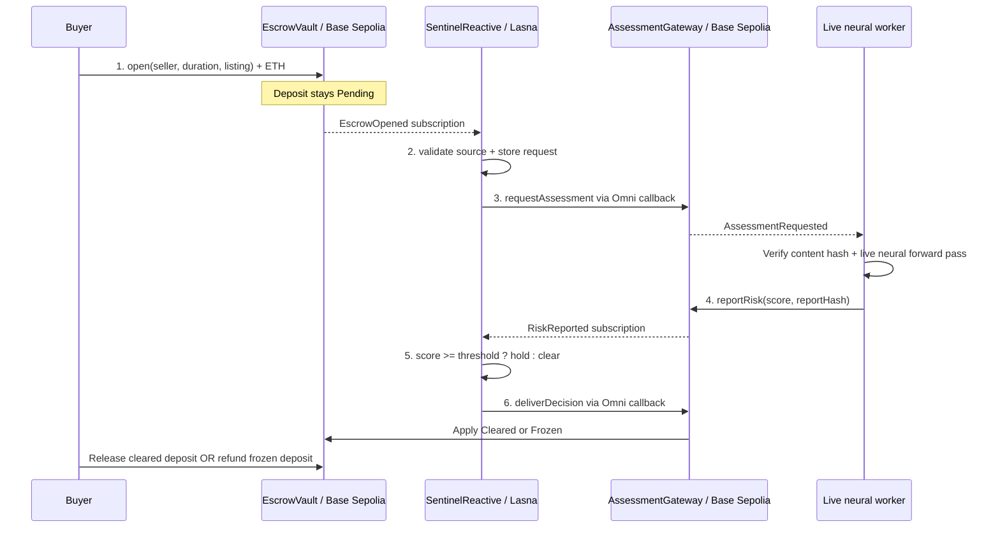

# Sentinel Escrow

**A live neural model assesses a trade. Reactive Omni enforces the decision. The buyer controls the money.**

Built from scratch on November 16, 2026 for the **Reactive Meets AI** track. This package is a working local prototype with testnet deployment tooling. It has **not** been registered, published, deployed to public chains, or submitted to DoraHacks.

## Start here

Install **Node.js 22 LTS or newer** (tested with Node 24.22.1) and npm. Unzip this directory, open a terminal in it, then:

```sh
npm ci
npm test
npm start
```

Open **http://localhost:3000**. Select a normal or high-risk listing, run the escrow, inspect the six transaction receipts, then release or refund the local deposit. No wallet, faucet, paid AI API, or external RPC is needed for this local demo. Keep the terminal running. Ctrl+C stops the server.

The checked-in model weights are ready to use. `node_modules` is intentionally excluded from the ZIP; `npm ci` downloads the pinned dependencies. On some Node/platform versions Ganache prints a native µWS warning and uses its working JavaScript fallback. The lockfile explicitly marks Ganache's bundled macOS-only `fsevents` package optional so clean Linux installs work; preserve the provided lockfile.

```sh
npm run demo              # Three complete local EVM runs; writes evidence/local-demo.json
npm run compile           # Solidity 0.8.29, Shanghai EVM, optimizer 200 runs
npm run train             # Reproduce the neural weights from the fixed training seed
node model/evaluate.mjs   # Held-out synthetic probe report, including failures
```

## What you get

| Component | Behavior |
| --- | --- |
| `EscrowVault.sol` | Holds buyer ETH; blocks payout while pending/frozen; buyer-only release; immediate frozen refund or timestamp timeout |
| `SentinelReactive.sol` | Omni event subscriptions, origin validation, immutable threshold, two callback stages, controlled retry |
| `AssessmentGateway.sol` | Authenticates proxy AND reactive sender; creates AI jobs; accepts one report from the pinned reporter |
| `src/worker.mjs` | Reads confirmed jobs, verifies listing commitments, executes neural inference, stores exact reports and commits hashes |
| `model/` | Reproducible 145-parameter MLP, checked-in weights, feature extractor and transparent evaluation |
| `web/` + local API | Responsive control room, custom inputs, transaction trace, evidence downloads, buyer release/refund controls |
| `scripts/` | Compile, deployment/resume, network checks, fee health, sample trades, operations and testnet evidence collection |
| `test/` | Contract authorization, state transitions, malicious inputs, replay/reentrancy protection, model and dashboard/API tests |
| `docs/` | Research, architecture, threat model, deployment guide, submission draft and a timed demo script |

## The actual loop



Both chain transports are **mocked only in the local lab**; the deployed contracts use Omni's current `requestCallbackV_1_0` interface and system contract. Local runs execute compiled Solidity on two distinct EVM instances, with six transaction receipts and live inference. They do not prove Lasna delivery, actual service fees, validator behavior or public-network latency.

## Why Reactive is essential

The model worker has permission to **report a score**, not change escrow state. Reactive initiates the job and applies the threshold. The destination accepts instructions only from the configured callback proxy and reactive contract. Removing Reactive leaves deposits pending until timeout. A low score never automatically pays a seller; the buyer still confirms release.

## Model and trust limits

The neural network is `10 features → 12 tanh neurons → sigmoid`, trained on 1,800 synthetic text examples. It runs for each job; AI is not limited to code generation. The model bytes and exact report JSON are hashed and checked against on-chain commitments.

This is a demonstration text-risk model, **not a validated fraud detector**. Features use a small English vocabulary; evasive phrasing and fabricated benign details can defeat it. The included 12 handwritten held-out probes produced **11 matching decisions and 1 miss**; this is not a real-world accuracy claim. See [MODEL_CARD.md](docs/MODEL_CARD.md).

Reports are trusted attestations from one configured reporter. Hashes prove which report was committed, not that a remote worker faithfully performed inference. There is no zkML, TEE or decentralized oracle claim. All listing text is public in transaction logs; do not enter secrets or personal data.

## Testnet and submission

Follow [DEPLOYMENT.md](docs/DEPLOYMENT.md). The scripts allow **Base Sepolia (84532) + Reactive Lasna (5318007)** only. No mainnet deployment path is provided. Use dedicated testnet accounts.

The public-chain evidence collector refuses to mark a bundle complete without matching origin events, two Reactive transactions, two callbacks, a committed model/report, and successful system callback records. Existing `evidence/local-demo.json` is explicitly local and must not be submitted as public testnet proof.

Read [RESEARCH.md](docs/RESEARCH.md) for verified rules and unresolved questions, and [SUBMISSION.md](docs/SUBMISSION.md) for the remaining external steps.

## Reproducibility and delivery

- Direct dependencies are pinned in `package.json`; transitive dependencies in `package-lock.json`.
- Model generation uses a fixed PRNG seed; weights are included.
- Compiler standard JSON input and ABI/bytecode artifacts are included in the download and regenerated by `npm run compile`.
- Local chains use ephemeral accounts and reset when the server exits. Archived runs are labeled and cannot be settled.
- Fresh current-session runs are recorded under ignored `.state/`; preserve downloaded evidence before restarting.
- The ZIP has no wallet keys, `.env`, dependencies, runtime checkpoints or false deployment addresses.
- See [VALIDATION.md](docs/VALIDATION.md) for performed checks and verification boundaries.

MIT license. This is an unaudited hackathon prototype; its testnet-first scope is intentional.
