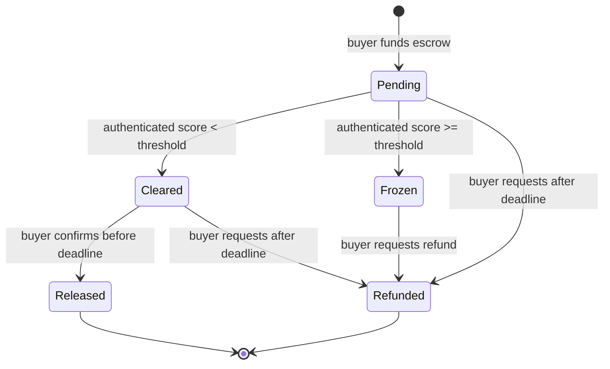

# Architecture and invariants

## Deployment topology

The origin chain (Ethereum Sepolia in the live deployment; Base Sepolia also supported) hosts `EscrowVault` and `AssessmentGateway`; Lasna hosts `SentinelReactive`. The worker is an ordinary long-running Node process using a dedicated Base Sepolia signer. It can run on a laptop or a persistent server. The included dashboard is a **local laboratory**, not a connected testnet wallet UI.

1. Deploy Reactive with chain ID, threshold and pinned model hash.
2. Deploy the vault, then gateway with proxy, Reactive address, reporter, vault and model hash.
3. Configure the vault's gateway once; configure Reactive's two exact subscriptions once.

Both one-time configuration functions are owner-only. There is no upgrade proxy and no post-configuration recipient or oracle replacement. A new model, reporter or threshold requires a new deployment. This simplifies the demo's trust boundary, at the cost of key-rotation flexibility.

## State machine

There is deliberately no seller-only payout. This is buyer-controlled escrow, not a neutral arbitration service. A seller must understand that a buyer can refuse release and reclaim a timed-out trade. Production commercial escrow would need separately designed delivery acceptance, dispute resolution and incentives.

## Invariants

- Only the registered gateway can submit an assessment to the vault.
- Only the chain's callback proxy plus the exact reactive sender can invoke gateway callback methods.
- Only the configured reporter can attest risk, once per requested job, before expiry.
- Reactive only accepts messages from its Omni system, with exact origin chain, source contract, event signature and topic count.
- The listing hash, report hash and score agree across the job, report, decision and callback.
- At or above the immutable threshold the trade freezes, including the exact boundary.
- A deposit begins held; a slow worker never opens a payout window.
- A callback cannot revive a refunded/released escrow, replace a first accepted decision, or release funds itself.
- Escrow transfers update state and accounting before external calls; reentrant refund is rejected.
- The vault has no fee-payment interface. Fee debt can stop automation but cannot spend buyer principal.
- Every time limit is a timestamp, not a block count.

## Durable worker

The worker scans jobs in bounded block chunks after a configurable confirmation delay. It checks the checkpoint block hash and rewinds up to 100 blocks on a mismatch. It locates the originating listing, verifies its keccak256 commitment, checks pending/unexpired state, runs inference and writes the exact report **before** submitting the attestation. Retries reuse these exact bytes, so a pending transaction cannot commit a report that was overwritten by a new inference. A conflicting persisted report context halts that batch for operator inspection. If it restarts after a successful transaction but before checkpointing, the on-chain `reported` bit skips a duplicate. Failed batches do not advance the cursor. Expired/finalized jobs are skipped.

Confirmation depth is not a guarantee against deep origin-chain reorgs. A >100-block reorg requires operator review and an earlier checkpoint. The reporter is single-process; do not run multiple competing instances with one key/state file. Malformed jobs or recurring RPC errors are logged and retried, which can stall a batch until the operator resolves them. This is an intentionally small worker, not a horizontally scaled queue.

## Report commitments

`modelHash = keccak256(exact weights.json bytes)`.

`contentHash = keccak256(UTF-8 listing)`.

`reportHash = keccak256(exact JSON.stringify(report) bytes)`.

The report includes model hash, job context, content hash, score, bounded features, wall-clock assessment timestamp, measured inference duration and the synthetic-training disclosure. The stored raw JSON has no appended newline. Reformatting the raw report changes its commitment. Local downloadable run bundles include `report.serialized`; the public evidence collector retains `reportSerialized`.

## Retry and fees

`retryDelivery(id)` is owner-only, rate-limited to once per 30 seconds, and bounded by the original deadline. It can only replay the already stored job or decision; it cannot alter a score or threshold. Duplicate callbacks are idempotent at the state-changing boundary. A failed callback can cost gas even when it changes no state.

Fund the reactive contract in testnet REACT and the gateway in Base Sepolia ETH. Direct transfers add fee balance; `coverDebt()` settles existing debt. `depositTo(address)` on the corresponding provider can also clear debt and credit reserves. The vault's ETH balance is not used for fees.
